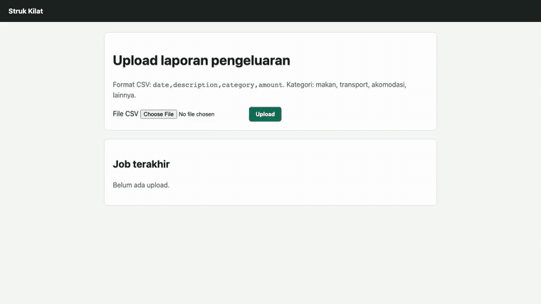
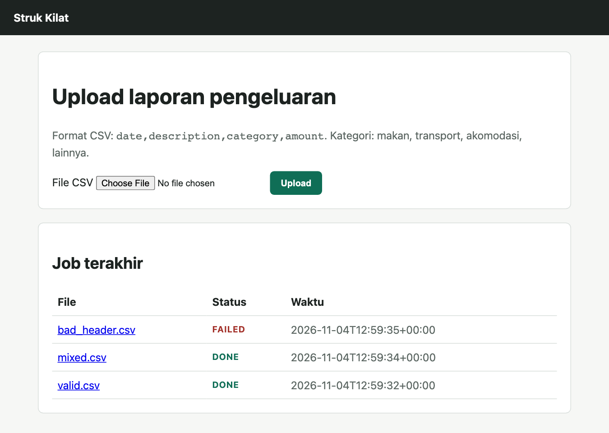
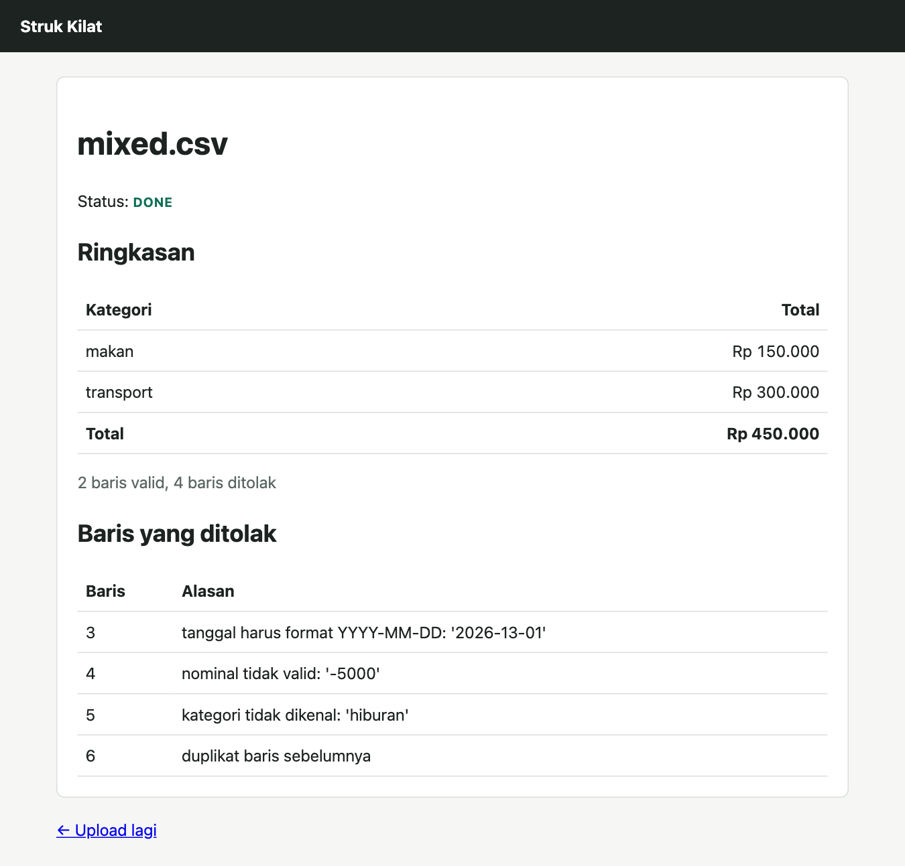
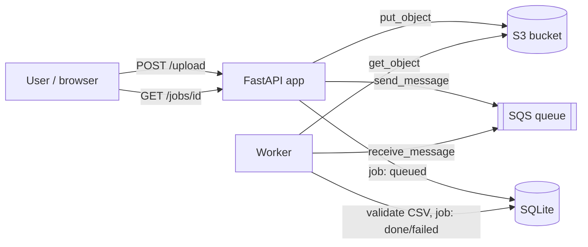

# Struk Kilat: SDET portfolio

[](https://github.com/seppam/sdet-portfolio/actions/workflows/tests.yml)


[](LICENSE)

A small expense-report app (CSV upload → S3 → SQS → worker), built so it could be
**tested in layers**: unit, API, integration against an AWS emulator, and E2E in a real browser.
The app is small on purpose. This repo is mainly about the **test strategy**.

> Bahasa Indonesia: dokumen strategi lengkap ada di [docs/test-strategy.md](docs/test-strategy.md).



*The journey above was recorded by Playwright against the app running on the moto emulator
(`status: processing → done` happens live as the worker picks up the SQS message).*

| Upload | Result with rejected rows |
|---|---|
|  |  |

The UI is in Indonesian (*struk* = receipt, *kilat* = lightning). The app validates every row
and explains each rejection instead of failing the whole file.

## Architecture



S3 and SQS run on an **emulator**, not real AWS:

| Emulator | Port | Notes |
|---|---|---|
| [moto server](https://docs.getmoto.org/en/latest/docs/server_mode.html) | 5055 | Open source, free, no account needed. Default for local dev and CI |
| [Floci](https://github.com/floci-io/floci) | 4566 | Free, MIT, LocalStack-compatible drop-in. Same tests pass; run with `make floci-up` |
| [`mini_aws/`](mini_aws/server.py) | 5066 | **Built from scratch here** (~400 lines, stdlib only) to learn how the AWS protocols work |

Why not LocalStack? Since March 2026 the latest LocalStack image needs an account and auth
token, CI included. moto covers everything this app needs, without an account, and
[Floci](https://github.com/floci-io/floci) is a free LocalStack-compatible alternative that
passes the same suite (integration 8/8, E2E 5/5).

## Test pyramid

| Layer | Folder | Count | What it proves | Speed |
|---|---|---:|---|---|
| Unit | `tests/unit` | 34 | Validation rules: boundary values, equivalence classes | ~0.1 s |
| API | `tests/api` | 19 | HTTP contract: status codes, error messages, side effects (uses a fake AWS) | ~0.2 s |
| mini-aws self-test | `tests/mini_aws` | 12 | The home-made emulator behaves like AWS (error codes, MD5, limits) | ~1 s |
| Integration | `tests/integration` | 8 | Real boto3 calls + emulator: visibility timeout, poison messages, missing objects | ~3 s |
| E2E | `tests/e2e` | 5 | Critical user journeys in Chromium (Playwright + Page Objects) | ~9 s |

**78 tests, ~14 s locally, 87% coverage.** In CI, the integration tests run against **three**
emulators (matrix: moto, Floci, mini-aws), so any gap between them shows up as a failing job.

## Bugs found while building it

Real bugs, all fixed. Three were caught by tests and each of those has a regression test;
BUG-003 was spotted by looking at screenshots.

| ID | Bug | Found by |
|---|---|---|
| [BUG-001](docs/bug-reports/BUG-001-ghost-queued-job.md) | A job stayed `queued` forever when S3 was down | API test using a fake that simulates an outage |
| [BUG-002](docs/bug-reports/BUG-002-job-stuck-processing.md) | A job got stuck at `processing` when the S3 object was missing | Integration test (the fake could **not** catch it) |
| BUG-003 | The "Total" amount was not right-aligned (`td.num` CSS missed the `th` cell) | Visual review of E2E screenshots |
| mini-aws | Emulator quietly capped `MaxNumberOfMessages` instead of rejecting it like AWS | mini-aws self-test, compared against moto |

## Quick start

```bash
make install        # uv sync + Playwright Chromium
make moto-up        # moto server in Docker on :5055
make test-all       # every test + HTML report in reports/
make dev            # app at http://localhost:8077
```

Other targets: `make help`. See the browser while E2E runs: `make test-e2e HEADED=1`.

Try the home-made emulator:

```bash
make mini-aws                  # terminal 1
make test-int-mini             # terminal 2: same integration tests, other emulator
```

## CI (GitHub Actions)

[`.github/workflows/tests.yml`](.github/workflows/tests.yml)

1. **fast**: ruff, unit, API, and mini-aws tests with a coverage report. This job fails fast and cheap.
2. **integration** (matrix `moto` × `floci` × `mini-aws`): moto runs as a service container, Floci via `docker run`.
3. **e2e**: Playwright with trace + screenshot kept **only on failure**.

Every job uploads an HTML report as an artifact. Open a failing trace with
`uv run playwright show-trace trace.zip`.

## Repository layout

```
app/            FastAPI app, worker, validation rules
mini_aws/       home-made S3 + SQS emulator
tests/
  unit/ api/ integration/ e2e/ mini_aws/
  fakes.py      in-memory test double for AWS
samples/        CSV files used by E2E and manual testing
docs/           test strategy, bug reports
```

## About

Built by **Muhamad Septian Pamungkas** as an SDET portfolio project, coming from manual QA.
It is a learning project, not production software.
Portfolio: [septian-pamungkas.vercel.app](https://septian-pamungkas.vercel.app)

## License

[MIT](LICENSE)
